# Add a native Plasma widget and installable Linux AppImage

Adds a KDE Plasma dock widget and packages the general Tauri UI as an installable,
updatable AppImage; both use the existing daemon.

- KDE: themed battery/ANC controls, EQ editing, device management, settings and a battery-ring icon.
- Tauri: resizable, pinnable three-tab panel with matching controls, automatic preferred-device saving and dismissible errors.
- Backend/packaging: validated BlueZ renaming with shared D-Bus updates, Arch KDE recipe, AppImage installer/update metadata, release workflow and tests.

Validated: Rust workspace, Tauri, frontend, installer and KDE offscreen tests;
local AppImage build/checksum. Live audio tests, KDE D-Bus integration, clean-distro
installation and the GitHub release workflow still need external validation.

Screenshots: KDE light/dark and Tauri

Demo device data. KDE uses the shared QML panel; Tauri uses its real frontend in
Firefox. See [capture instructions](screenshots/README.md).

| Feature | KDE light | KDE dark | Tauri |
| --- | --- | --- | --- |
| Controls | 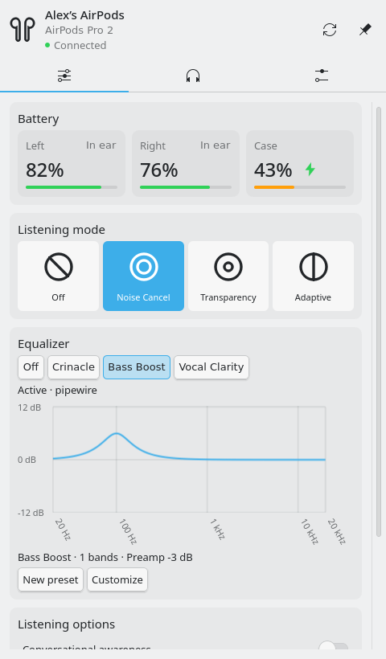 | 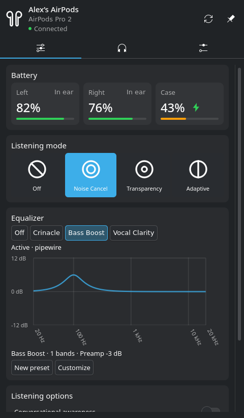 | 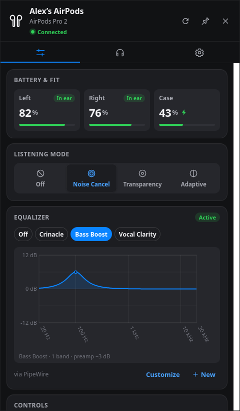 |
| EQ editor | 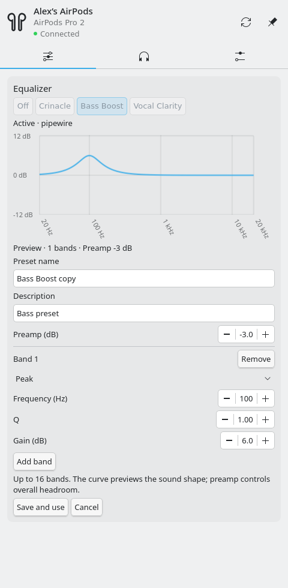 | 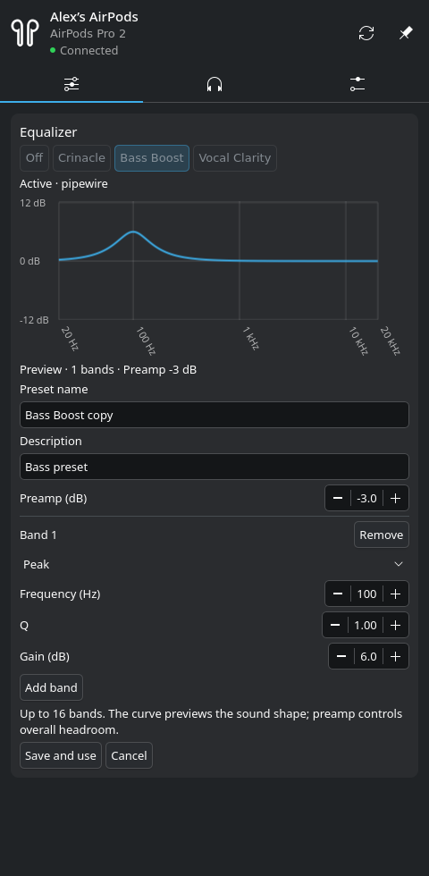 | 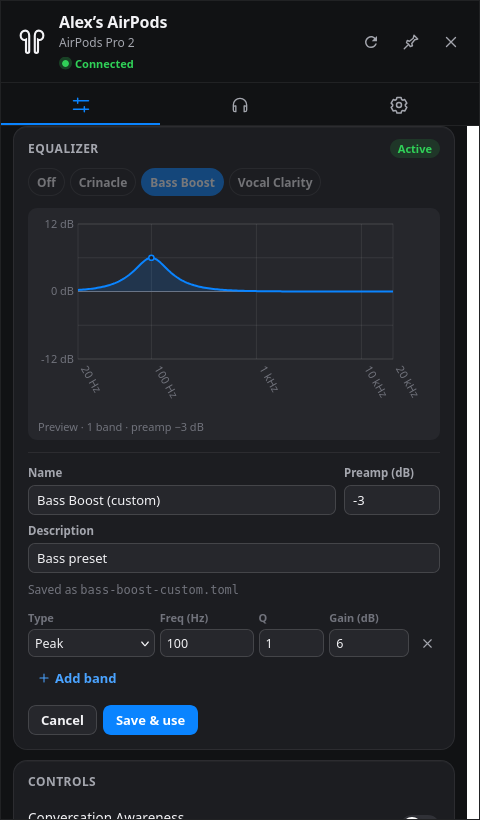 |
| Devices | 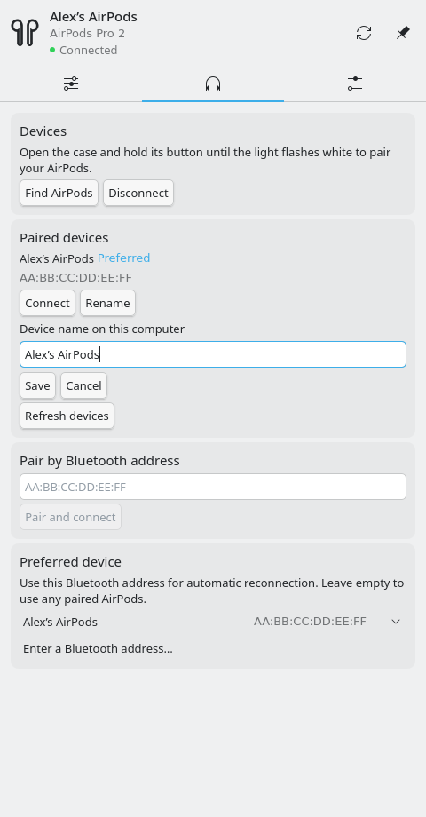 | 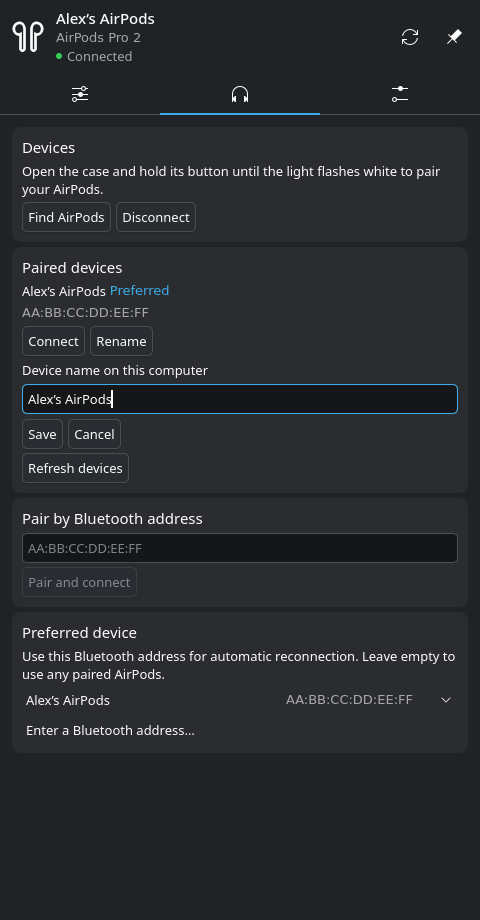 | 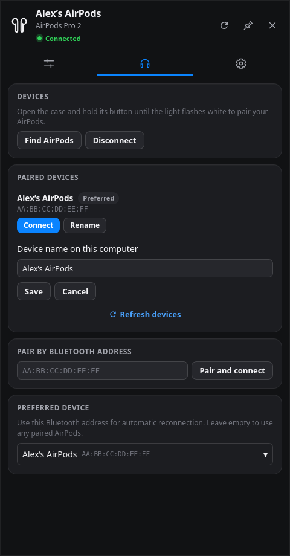 |
| Settings/About | 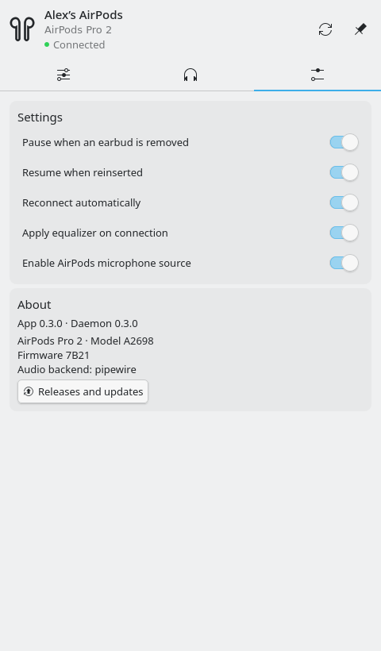 | 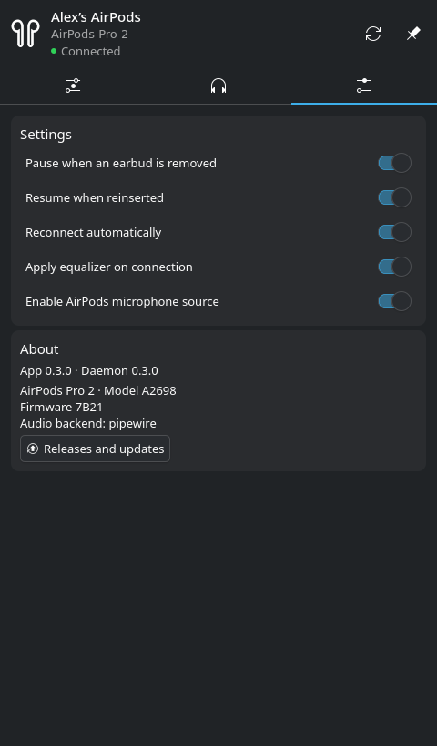 | 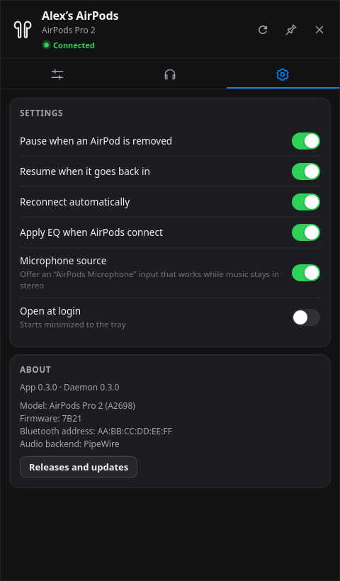 |

Tray icons:

| KDE light | KDE dark | Tauri |
| --- | --- | --- |
|  |  |  |

